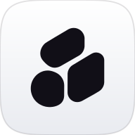

<p align="center">
  
</p>

<h1 align="center">Dacre</h1>

<p align="center"><strong>Your code. Your models. Your control.</strong></p>

<p align="center">
  <a href="./docs/user/install.md">Run from source</a> ·
  <a href="./docs/README.md">Docs</a> ·
  <a href="./ROADMAP.md">Roadmap</a> ·
  <a href="./CHANGELOG.md">Changelog</a>
</p>

Dacre is a desktop and web workspace for the coding agents on your machine. It drives Claude Code, Codex, Cursor, OpenCode, Grok Build, Antigravity, Kiro, Pi, Muse Code, fx and any [ACP](./docs/user/providers-acp.md) agent from one fast interface. If an agent is set up on your computer, Dacre can control it.

## What you get

- **Your subscriptions.** Dacre does not resell tokens. It drives the agents you already pay for and are signed in to.
- **Agent modes.** Ask, Plan, Agent, Architect, Debug, Review, Parallel, Performance, UI/UX, Research and 3D, plus modes you write yourself. Switch with the picker, `mod+.` or a command such as `/plan`. Read-only modes are enforced through each provider's own plan mode or sandbox where it has one.
- **Brain.** A local memory of your project's conventions, decisions and known issues. Agents search it and add what they learn. Only you can pin, edit or delete entries, and it refuses to store secrets.
- **Every agent in one place.** Change models in the middle of a thread. Let Claude hand a task to Codex, or split work across agents in separate worktrees. Mission Control shows every agent that is running, waiting on you, or done today. Add an MCP server once and every agent that can take it gets its tools.
- **Review before you keep it.** Each finished turn shows whether its tests, lint, type checks and builds passed, read from exit codes rather than the agent's word. Ask another agent for a second opinion, or revert one file of a turn.
- **A workspace, not a chat window.** Split panes, a terminal, diffs, a browser preview, file previews including 3D models, Go to symbol, and a command palette for everything.
- **Remote ready.** Run agents on any machine and connect over your local network or Tailscale.
- **Git built in.** Each thread can work in its own worktree. Review the diff, then commit, push and open a pull request.
- **Local and open.** Your data stays on your machine, telemetry is off, and the code is MIT licensed.

## Status

Dacre supports Windows, Linux and macOS through its desktop app, plus the web client in a browser. There are no iOS or Android apps.

Dacre is early. There are no published releases yet, so you run it from source or build the Windows installer yourself. The installer is not code-signed, so Windows SmartScreen warns before it runs. The macOS and Linux builds have not been built or tested in this fork. [ROADMAP.md](./ROADMAP.md) lists what is done and what is next.

## Run from source

You need Git, [Node.js 26.13.1](https://nodejs.org/), and [pnpm 12.14.0](https://pnpm.io/).

```bash
git clone https://github.com/DacreDev/Dacre.git
cd Dacre
pnpm install
pnpm exec vp run dev
```

On Windows, clone with `git clone -c core.longpaths=true https://github.com/DacreDev/Dacre.git`.

Open the pairing URL the dev server prints. To run the desktop app instead, use `pnpm exec vp run dev:desktop`.

### Build the Windows installer

```bash
pnpm exec vp run dist:desktop:win:x64
```

The installer lands in `release/`. [Windows installer prerequisites](./docs/operations/00_development.md#windows-installer-prerequisites) lists the build tools it needs.

### Sign in to an agent

Dacre needs one agent that is installed and signed in. For example, install [Claude Code](https://claude.com/product/claude-code) and run `claude auth login`, or install [Codex CLI](https://developers.openai.com/codex/cli) and run `codex login`.

[Provider setup](./docs/user/install.md#providers) has the steps for each agent.

## Documentation

- [Install and first run](./docs/user/install.md)
- [Remote access from another machine](./docs/user/remote-access.md)
- [Permission modes](./docs/user/permission-modes.md)
- [Source control](./docs/user/source-control.md)
- [MCP servers](./docs/user/mcp-servers.md)
- [Connect outside agents over MCP](./docs/user/outside-agents.md)
- [FAQ](./docs/user/faq.md)

[All docs](./docs/README.md) has the full list.

## Contributing

Read [CONTRIBUTING.md](./CONTRIBUTING.md) before you open a pull request, and follow the [code of conduct](./CODE_OF_CONDUCT.md). The [development runbook](./docs/operations/00_development.md#first-checkout) covers setup, and the [architecture overview](./docs/internals/01_architecture.md) explains how it works.

## Support Dacre

Dacre is built for developers who want freedom, performance and control. If it helps you build better software, star the [repository](https://github.com/DacreDev/Dacre), report bugs, improve the docs or send a pull request.

## Credit

Dacre is an independent fork of [T3 Code](https://github.com/pingdotgg/t3code) by T3 Tools Inc., used under the MIT License. It is not affiliated with or endorsed by T3 Tools Inc. See [NOTICE](./NOTICE). <!-- rename-scan: T3 input on purpose -->

## License

[MIT](./LICENSE)
